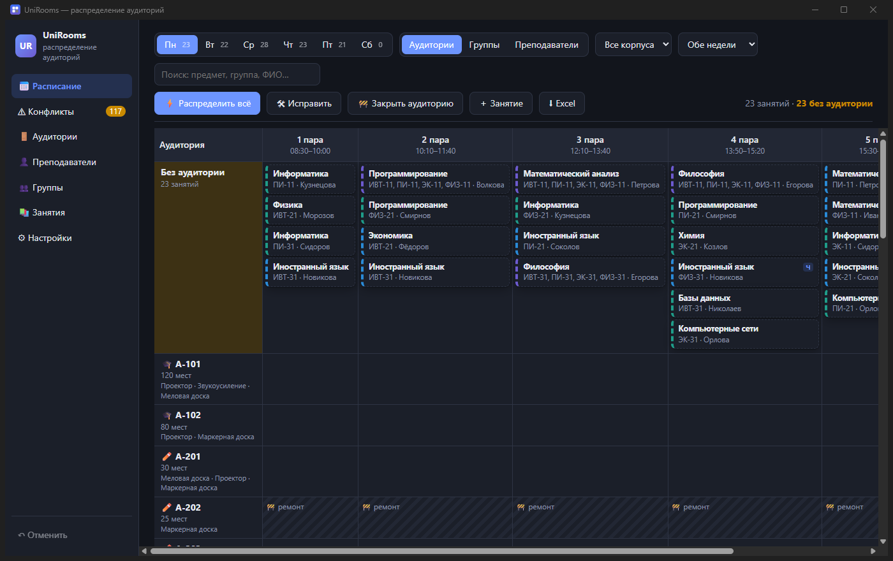

# UniRooms — распределение аудиторий в университете

Локальное приложение для Windows (один `.exe`, без интернета и без установки), которое
автоматически распределяет занятия по аудиториям с учётом оборудования, вместимости,
предпочтений преподавателей и групп — и позволяет быстро вносить изменения вручную.



**Скачать:** [последний релиз → UniRooms.exe](https://github.com/xSUSASos/UniRooms/releases/latest)

---

## 1. Суть идеи

Система:

1. Хранит **справочники**: аудитории (оборудование, места, ПК, корпус), преподаватели
   (с предпочтениями), группы и занятия.
2. **Автоматически распределяет** занятия по аудиториям так, чтобы жёсткие правила
   соблюдались всегда, а пожелания — максимально.
3. Позволяет **быстро менять**: закрылась аудитория, перенесли пару, добавили группу —
   система пересчитывает только то, что затронуто, не перетряхивая всё расписание.
4. Имеет **понятный визуальный интерфейс**: сетка-«шахматка», перетаскивание мышью,
   подсветка допустимых ячеек, список конфликтов, отмена действий.

### Почему не нейросеть

Составление расписания — это задача **оптимизации с ограничениями** (timetabling).
Нейросеть здесь плоха: нет обучающих данных, и она не гарантирует, что в одной
аудитории не окажутся две пары сразу. Поэтому «мозг» системы — **солвер ограничений
Google OR-Tools CP-SAT**: бесплатный, локальный, гарантирует выполнение жёстких правил,
находит оптимум по мягким и умеет сказать, почему решения нет.

Локальная LLM (через Ollama) может быть добавлена позже как **помощник**:
перевод текстовых пожеланий в правила («Петров не любит 3-й корпус»), команды в чате,
объяснение решений. Солвер решает — LLM помогает общаться.

---

## 2. Модель данных

| Сущность | Поля |
|---|---|
| **Оборудование** | код, название (справочник расширяемый: меловая/маркерная/интерактивная доска, проектор, ПК, звук, …) |
| **Аудитория** | номер, корпус, этаж, мест, тип (лекционная / практическая / лаборатория / компьютерный класс), кол-во ПК, оборудование, доступность для маломобильных, активна ли |
| **Недоступность аудитории** | аудитория, день (или все), пара (или все), причина — ремонт, мероприятие |
| **Преподаватель** | ФИО, кафедра, нужна ли доступная среда, недоступные слоты, **предпочтения с весами** |
| **Группа** | название, курс, численность, «домашний» корпус |
| **Занятие** | дисциплина, тип (лекция/практика/лаба), преподаватель, группы (поток), день, пара, неделя (все / числитель / знаменатель), нужное оборудование, минимум ПК, назначенная аудитория, флаг 🔒 «закреплено» |
| **История** | каждое изменение расписания — для отмены (Ctrl+Z) |

Предпочтение преподавателя — это запись `{вид, значение, режим, вес}`, например:
`{корпус, "Б", избегать, 8}`, `{оборудование, "projector", предпочитать, 5}`,
`{аудитория, "А-101", предпочитать, 3}`, `{макс. этаж, 2, —, 6}`.

---

## 3. Правила

**Жёсткие (нарушать нельзя):**
- в одной аудитории в одно время — одно занятие (с учётом числителя/знаменателя);
- мест ≥ суммарной численности групп занятия;
- есть всё обязательное оборудование и нужное число ПК;
- аудитория активна и не закрыта в этот слот;
- доступная среда, если она нужна преподавателю;
- закреплённые 🔒 занятия солвер не двигает.

**Мягкие (с настраиваемыми весами):**
- предпочтения преподавателей;
- аудитория по размеру (15 человек — не в зал на 200);
- тип аудитории соответствует типу занятия;
- группа — в своём «домашнем» корпусе;
- минимум переходов между корпусами между соседними парами (для групп и преподавателей);
- **стабильность**: при пересчёте менять как можно меньше.

Конфликты, которые нельзя решить выбором аудитории (преподаватель или группа в двух
местах сразу, преподаватель недоступен), система не прячет — показывает в списке
«Конфликты».

---

## 4. Алгоритм

1. **Полное распределение** — CP-SAT получает все занятия и строит оптимальное назначение.
2. **Режим «Исправить»** (быстрые изменения) — всё, что корректно, штрафуется за сдвиг,
   поэтому меняются только проблемные занятия.
3. **Подсказка** — для выбранного занятия мгновенно оцениваются все аудитории:
   топ вариантов с объяснением (✅ проектор, ✅ 30 мест, ⚠ другой корпус).
4. **Подсветка при перетаскивании** — зелёный (идеально), жёлтый (с компромиссами),
   красный (нельзя, с причиной).
5. **Если решения нет** — занятие остаётся без аудитории, и система объясняет почему
   (нет подходящих по оборудованию, все подходящие заняты и т.п.).

---

## 5. Интерфейс

- **Расписание** — сетка по аудиториям / группам / преподавателям на выбранный день;
  фильтры по корпусу, неделе, поиск; перетаскивание карточек; клик по карточке —
  панель занятия с подсказками аудиторий и замочком 🔒.
- **Быстрые действия** — «Закрыть аудиторию» (ремонт/мероприятие) с автоматическим
  перераспределением затронутых пар; «Распределить всё»; «Исправить»; «Отменить».
- **Конфликты** — список проблем с переходом к занятию.
- **Справочники** — аудитории, преподаватели, группы, занятия: таблицы с поиском и
  формами-карточками (галочки оборудования, предпочтения с ползунком веса).
- **Настройки** — время пар, веса правил, справочник оборудования,
  импорт/экспорт Excel, демо-данные.

---

## 6. Технологии

| Слой | Выбор |
|---|---|
| Бэкенд | Python 3 + FastAPI |
| Солвер | Google OR-Tools CP-SAT |
| БД | SQLite (`%APPDATA%\UniRooms\unirooms.db`) |
| Фронтенд | React + TypeScript + Vite (без внешних UI-библиотек) |
| Окно приложения | pywebview (встроенный Edge WebView2 в Windows 10/11) |
| Excel | openpyxl |
| Сборка | PyInstaller → один `UniRooms.exe` |

---

## 7. Этапы

| № | Этап | Статус |
|---|---|---|
| 0 | Требования, формат данных | ✅ заложено в модель (уточняется на реальных данных) |
| 1 | БД, справочники, импорт/экспорт Excel | ✅ |
| 2 | Проверка жёстких правил, список конфликтов | ✅ |
| 3 | CP-SAT с мягкими правилами и весами | ✅ |
| 4 | Сетка, перетаскивание, подсветка допустимых ячеек | ✅ |
| 5 | Режим «Исправить», закрытие аудиторий, история и отмена | ✅ |
| 6 | Пилот на одном факультете, доработка по отзывам диспетчеров | ⏳ |
| 7 | Автоподбор **времени** пар (сейчас время задаётся, а солвер подбирает аудитории) | ⏳ |
| 8 | LLM-помощник (Ollama): текстовые команды и пожелания | ⏳ |
| 9 | Многопользовательский режим (PostgreSQL), просмотр для преподавателей/студентов | ⏳ |

---

## 8. Риски

- **Грязные данные** — реальная вместимость/оборудование расходятся с бумагами → проверка при импорте.
- **Противоречивые пожелания** — решаются весами и отчётом о невыполненном.
- **Числитель/знаменатель, потоки, подгруппы** — заложены в модель с самого начала.
- **Масштаб** — сотни аудиторий и тысячи занятий CP-SAT решает за секунды–минуты
  (лимит времени настраивается).
- **Принятие людьми** — у диспетчера последнее слово: замочек, ручное перетаскивание, объяснения.

---

## Использование

1. Скачайте `UniRooms.exe` из раздела **Releases** и запустите.
2. При первом запуске загружаются **демо-данные** — можно сразу пробовать.
3. Свои данные: *Настройки → Экспорт данных в Excel* даёт шаблон со всеми листами;
   заполните его и загрузите через *Импорт из Excel*.
4. *Расписание → Распределить всё* — автоматическое распределение.
5. Перетаскивайте карточки, закрывайте аудитории, нажимайте *Исправить* — меняется только нужное.

Если WebView2 недоступен, приложение откроется в браузере по умолчанию.

## Разработка

```bash
# бэкенд
python -m venv .venv
.venv\Scripts\pip install -r requirements.txt
# фронтенд
cd frontend && npm install && npm run build && cd ..
# запуск (окно приложения)
.venv\Scripts\python -m app.main
# режим разработки: API на :8765 + vite dev-сервер на :5173
.venv\Scripts\python -m app.main --server
cd frontend && npm run dev
# тесты
.venv\Scripts\python -m pytest
# сборка exe → dist\UniRooms.exe
build.bat
```

### Структура

```
app/
  main.py      — точка входа: сервер + окно
  db.py        — схема SQLite и доступ к данным
  checker.py   — жёсткие/мягкие правила, конфликты, оценка аудиторий
  solver.py    — CP-SAT: полное распределение и режим «Исправить»
  api.py       — REST API
  excel_io.py  — импорт/экспорт Excel
  seed.py      — демо-данные
frontend/      — React + TypeScript
tests/         — pytest
```
